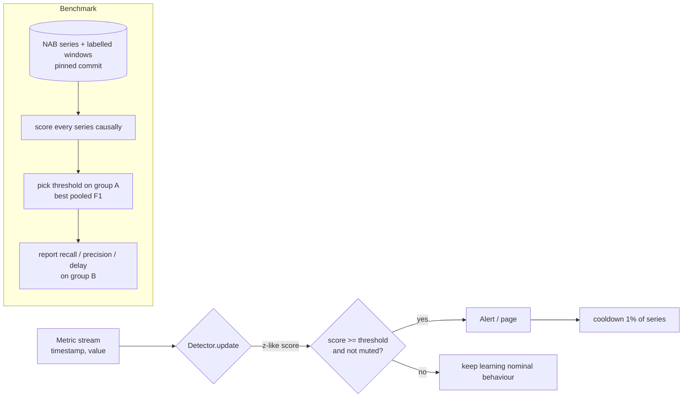

# streamwatch: online anomaly detection for real-time supervision, measured honestly on NAB

[](https://github.com/Adversitas/stream-anomaly-supervision/actions/workflows/ci.yml)

Supervision tools for communicating systems (servers, networked equipment, industrial
controllers) need anomaly detectors that **model each signal's nominal behaviour, run point by
point in real time, and page someone only when it matters**. This project implements five such
detectors in pure Python (no dependencies) and evaluates them as an on-call team would experience
them, on the 23 real-world series of the
[Numenta Anomaly Benchmark](https://github.com/numenta/NAB) (`realKnownCause` and
`realAWSCloudwatch`: machine temperature, EC2 CPU and network, request latency, NYC taxi demand,
and others).

| Detector | Nominal model | Cost per point |
|---|---|---|
| Rolling z-score | mean / std over the last 288 points (running sums) | O(1) |
| EWMA control chart | exponentially weighted mean and variance | O(1) |
| Rolling median / MAD | robust centre and spread over 288 points | O(w log w) |
| Seasonal profile | per (weekday, hour) EWMA level and deviation | O(1) |
| Ensemble | median of the four scores | sum of the above |

## Evaluation protocol

- **Causal**: the score of point *t* uses only points before *t* (a unit test checks this).
- **Probation**: no alert in the first 15 % of each series, as in NAB.
- **Cooldown**: after an alert the detector is muted for 1 % of the series length, so one
  incident gives one page.
- **Recall** = labelled anomaly windows with at least one alert. **Precision** = alerts that fall
  inside a window. **Delay** = time from window start to first alert, as a share of the window.
- **No in-sample tuning**: the threshold is picked on one NAB group (best pooled F1 over a fixed
  grid) and reported on the *other* group, in both directions.

## Results (held-out group, pinned NAB commit `ea702d7`)

Produced by `streamwatch benchmark` (see `reports/results.md`).

**Tuned on realAWSCloudwatch (16 series) → tested on realKnownCause (7 series, 18 windows)**

| Detector | Threshold | Windows detected | Recall | Alerts | Precision | F1 | Median delay |
|---|---|---|---|---|---|---|---|
| **Rolling z-score** | 7.0 | 8/18 | 0.444 | 24 | **0.375** | **0.407** | 0.67 |
| EWMA control chart | 7.0 | 7/18 | 0.389 | 28 | 0.286 | 0.329 | 0.67 |
| Rolling median / MAD | 5.0 | 10/18 | 0.556 | 135 | 0.096 | 0.164 | 0.50 |
| Seasonal profile | 10.0 | **15/18** | **0.833** | 123 | 0.163 | 0.272 | **0.38** |
| Ensemble (median) | 7.0 | 8/18 | 0.444 | 47 | 0.191 | 0.268 | 0.67 |

**Tuned on realKnownCause → tested on realAWSCloudwatch (16 series, 30 windows)**

| Detector | Threshold | Windows detected | Recall | Alerts | Precision | F1 | Median delay |
|---|---|---|---|---|---|---|---|
| **Rolling z-score** | 7.0 | 20/30 | 0.667 | 104 | **0.269** | **0.384** | 0.50 |
| EWMA control chart | 7.0 | 21/30 | 0.700 | 117 | 0.205 | 0.317 | 0.50 |
| Rolling median / MAD | 3.0 | **29/30** | **0.967** | 702 | 0.141 | 0.246 | **0.19** |
| Seasonal profile | 12.0 | 26/30 | 0.867 | 507 | 0.148 | 0.253 | 0.31 |
| Ensemble (median) | 10.0 | 16/30 | 0.533 | 165 | 0.212 | 0.304 | 0.50 |

Throughput (single core, pure Python): rolling z and EWMA run at 0.6–3 M points/s, the seasonal
profile at about 300 k points/s, MAD and the ensemble at 6–11 k points/s.

What the numbers say:

- **No detector dominates.** The cheapest one (rolling z-score) has the best held-out F1 in both
  directions, but it detects fewer than half of the incidents in `realKnownCause`.
- **There is a clear recall / alert-volume trade-off.** The seasonal profile catches 15 of 18
  known-cause incidents and fires earlier (38 % into the window vs 67 %), at the cost of five
  times more pages. MAD at a low threshold catches 29/30 AWS windows but pages 702 times.
- **The ensemble did not help.** Taking the median of four scores diluted the strong detectors'
  signal. Picking the detector *per signal family* (seasonal for business metrics like taxi
  demand, z-score for infrastructure metrics) is the obvious next step, and it is what a
  supervision team would configure.
- Absolute F1 values around 0.3–0.4 are typical of strict window-level scoring on NAB. The
  labelled windows are wide and some incidents are only visible in hindsight.

Example: replaying the machine-temperature series (22,695 readings at 5-minute intervals) as a
stream, the rolling z-score at threshold 7 first pages at **2013-12-15 20:35**, inside the
labelled window that starts 17:50 that day. It pages again at **2014-02-09 12:00**, two hours
before the end of the window that leads to the documented machine failure.

```bash
streamwatch watch data/nab/realKnownCause/machine_temperature_system_failure.csv --detector rolling_z --threshold 7
```

## Architecture



```
src/streamwatch/
  detectors.py  RollingZ, EWMAControl, RobustMAD, SeasonalProfile, Ensemble
  nab.py        pinned download of NAB series and label windows
  evaluate.py   probation, cooldown, window recall/precision/delay, cross-group tuning
  cli.py        streamwatch {fetch, benchmark, watch}
```

## How to run

```bash
python -m venv .venv && . .venv/bin/activate      # Windows: .venv\Scripts\activate
pip install -e ".[dev]"

streamwatch fetch                  # 23 NAB series + labels into data/nab (pinned commit)
streamwatch benchmark              # both tuning directions -> reports/results.{json,md}
streamwatch watch data/nab/realKnownCause/nyc_taxi.csv --detector seasonal --threshold 10

pytest -q && ruff check . && ruff format --check .
```

CI (Python 3.10 and 3.12) runs lint, format, 16 tests (spike detection for every detector,
causality, flat signals, level shifts, seasonal vs global, probation/cooldown, metric counting,
benchmark on a fixture), then downloads NAB and runs the full benchmark plus a stream replay.

## Limitations

- **Univariate**: each metric is watched alone. Correlating alerts across the metrics of the same
  host or chain would cut false pages and is not done here.
- **Fixed hyper-parameters** (window 288, alpha 0.02 / 0.1). Only the threshold is tuned, on a
  coarse grid, to keep the held-out protocol clean.
- **Window-level scoring** differs from the official NAB score, which rewards early detection
  with a sigmoid. The numbers here are not comparable with the NAB leaderboard.
- 23 series and 48 windows is a small sample, so a single window moves recall by 2–6 points.

## En bref (FR)

Cinq détecteurs d'anomalies en ligne, en Python pur : z-score glissant, carte de contrôle EWMA,
médiane/MAD, profil saisonnier jour × heure, et ensemble. Ils modélisent le comportement nominal
de chaque signal et tournent point par point pour la supervision temps réel. L'évaluation se fait
sur les 23 séries réelles du Numenta Anomaly Benchmark, avec seuil réglé sur un groupe et mesuré
sur l'autre, période probatoire et anti-rafale d'alertes. Le z-score glissant offre le meilleur F1
hors échantillon (0,41 et 0,38). Le profil saisonnier détecte 15 incidents sur 18 et plus tôt,
mais génère cinq fois plus d'alertes. L'ensemble n'apporte pas de gain : il vaut mieux choisir le
détecteur par famille de signaux.

## License

MIT for the code. NAB data © Numenta, MIT licence, downloaded at a pinned commit and not
redistributed here.
